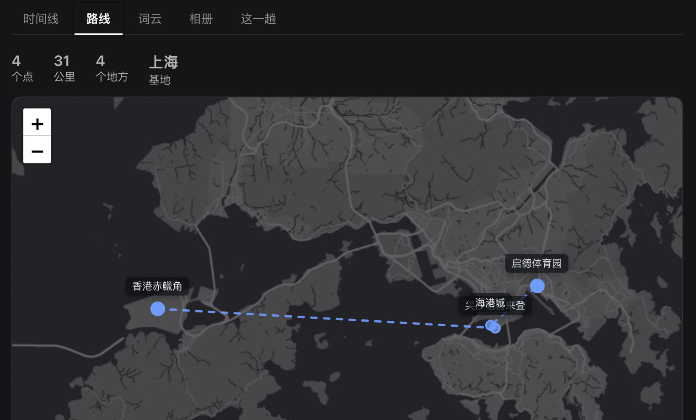

# 行程记录 · dsh-trip-log

**Turns a folder of trip notes into a timeline, route map, word cloud and photo album.**

A UI plugin for DeepSeek Harness (DSH). You already wrote down what happened — in a journal, in a chat log,
in a folder of screenshots. Trip Log reads those notes and lays them out as five views you can actually browse.
Your notes stay plain markdown inside your own git repo; the plugin only reads them, draws them, and
commits your edits back when you change the intro card.

No API keys, no accounts, no backend.

五个页签：**时间线 · 路线 · 词云 · 相册 · 总结**。



---

## What it's for

出门那几天说过的话，散在聊天记录里、日记里、相册里。回头看，你想知道的是：

- 那天几点在哪儿、干了什么 → **Timeline**
- 一共跑了多少公里、走过哪几个点 → **Route**
- 那几天嘴里念得最多的是什么 → **Word cloud**
- 拍的照片按时刻排开 → **Album**
- 一句话概括这趟、最舍不得的几件事 → **Summary**

这个插件不生成内容。**它只吃你自己写的档案**，因为你记得的东西比别人总结的准。

## 装

还没发 npm，从源码装：

```bash
git clone https://github.com/Ricardozhuyuyu/dsh-trip-log.git
cd dsh-trip-log
```

然后在 DSH 里装这个目录（`plugin_manager install_bundle`，target 填**绝对路径**，比如 `/Users/you/code/dsh-trip-log`）。
没发 npm，所以不要按包名装。

装完重启 DSH，左侧栏出现「行程记录」图标。

## 数据长什么样

在 `档案根目录` 下，**一趟一个子目录**，里面一份 `档案.md`：

```
旅程/
  京都-2026-04-02/
    档案.md
    图/
      2026-04-03-岚山-0912.png
  大理-2026-08-14/
    档案.md
    图/
      ...
```

`档案.md` 就这么写：

```markdown
# 京都 · 2026-04-02 → 04-05

清明四天，看樱花。前两天在岚山和市区，第三天去了宇治。

---

## 行程

**04-02 周四**

- 08:15 出门，地铁去机场。
- 10:40 起飞。
- 14:05 落地关西。

**04-03 周五**

- 09:00 岚山，竹子那段人不多。
- 12:30 渡月桥边吃汤豆腐。
- 16:00 回市区。

## 吃了什么

- 汤豆腐。
- 锦市场：玉子烧、抹茶团子。

## 记着

四条通的樱花。风一过整条街都在往下掉，站在那儿看了很久。

清单。出发前记的要做的三件事：

- 买一日券
- 去一次钱汤
- 带一盒抹茶回来

## 基地

上海

## 坐标

- 关西机场 34.4347 135.2320
- 岚山 35.0094 135.6668
- 渡月桥 35.0129 135.6777
- 锦市场 35.0050 135.7649
```

### 解析规则

| 写法 | 意思 |
|---|---|
| `# 标题` | 卡片标题 |
| `---` 之前 / 第一个 `##` 之前 | 介绍段，**页面上可以直接点开改**，存回文件并自动 commit + push |
| `## 行程` | 一个分组；名字随便，`行程`/`出过的事`/`吃了什么` 都行 |
| `### 11-07 下午` | 分组里的日期段，会被记成 `day` |
| `**10-31 周六**` | 同上，单独一行的小标题 |
| 一行里有好几个 `HH:MM` | 会自动拆成多条，各自挂在自己的时刻上 |
| `## 记着` | 总结页「记着的几件事」从这一节取。冒号结尾的引导句会把下面紧跟的列表项收成「（N 项）」，不占位置 |
| `## 基地` | 出发地，**不画在路线上**，只做标注 |
| `## 坐标` | 每行 `名字 纬度 经度`，画路线用 |
| `## 图` | 会被跳过（图片按 `图/` 目录里的文件自动排） |

**坐标一律存 WGS-84**。OSM / Esri / CARTO 的瓦片都是 WGS-84 基准，全球一致，不偏移。从高德（GCJ-02）或百度（BD-09）抄来的坐标在国内会偏几百米，别直接粘。

## 地图

用 Leaflet + Esri 暗色画布瓦片，**不需要任何 API key，不需要注册开发者**。

- 瓦片挂了（`tileerror` 累计 3 次）会自动切 OpenStreetMap 兜底，再挂就退回手绘 SVG，不会白屏
- 跨 180° 经线的路线（上海 → 旧金山）目前会绕反方向，**未处理**

## 配置

```yaml
- id: trip-log
  name: dsh-trip-log
  config:
    root: '~/Documents/trip-notes'
```

`root` 不给就用上面这个默认值。

## 存储

插件本身**不存数据**。它通过本地 HTTP（`/trip-log?action=...`，只监听 127.0.0.1）读你的 markdown 和图片，改介绍段时写回文件并调 `git commit` + `git push`（仓库没初始化就只写文件）。

## 许可

MIT
